# Guia prático da loja

Produto: DaFabi Frangos | Versão: branch fix/qa-25-11 (b05b67c) | Data: 2026-11-27 | Público: Fabiana (administradora) e operadores de caixa

Como usar o sistema no dia a dia da loja: abrir o caixa, vender, receber mercadoria, lançar despesas, desfazer uma venda e fechar o caixa. As telas vêm do sistema em funcionamento, com dados de exemplo. Quem responde com este guia, pessoa ou IA, responde só com o que está escrito aqui; se faltar algo, fale com a equipe que desenvolveu o sistema.

## Quem faz o quê

- **Administradora (Fabiana):** vê tudo. Só ela faz estornos, lança despesas, registra compras, cadastra fornecedores e vê o Dashboard.
- **Operador de caixa:** vê Nova venda, Histórico de vendas, Caixa, Produtos e Estoque. Abre o caixa, vende e fecha o caixa.

Cada pessoa entra com o próprio usuário e senha. O sistema registra quem abriu e fechou o caixa e quem fez cada estorno.

**Antes de usar como controle principal:** a equipe ainda precisa conferir com a Fabiana a contagem inicial do estoque, os relatórios reais do iFood e da 99Food e o leitor de código de barras da loja.

Fontes: Perfis e acessos do sistema; Regras de caixa, vendas, estorno e compras do sistema; Pendências antes de usar o sistema como controle principal; Gravação do sistema em funcionamento em 27/11/2026, com dados de exemplo (acessos, regras, homologacao, gravacao).

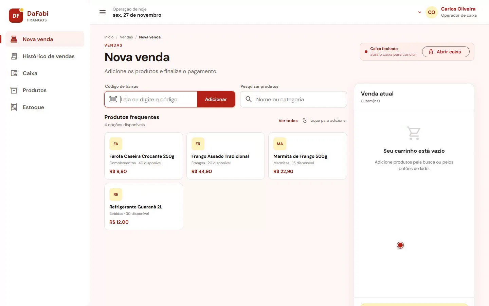
## Abrir o caixa

Sem caixa aberto, nenhuma venda é concluída. O PDV mostra o aviso "Caixa fechado".

1. Clique em **Abrir caixa** no aviso do PDV, ou vá em **Caixa**.
2. Conte o dinheiro da gaveta e digite o total em **Saldo inicial**.
3. Clique em **Abrir caixa** e confirme na janela.

O **Resumo do caixa** mostra o caixa aberto, com o seu nome e o horário.

Fontes: Gravação do sistema em funcionamento em 27/11/2026, com dados de exemplo; Regras de caixa, vendas, estorno e compras do sistema (gravacao, regras).

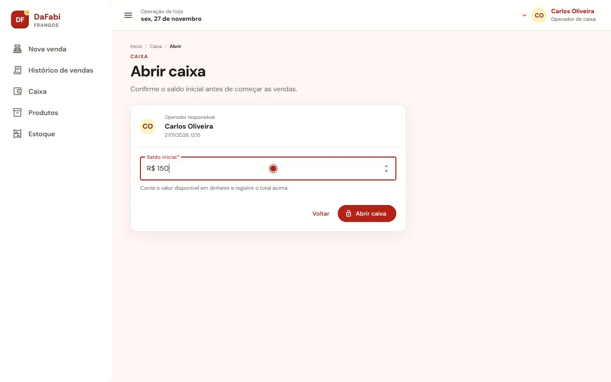
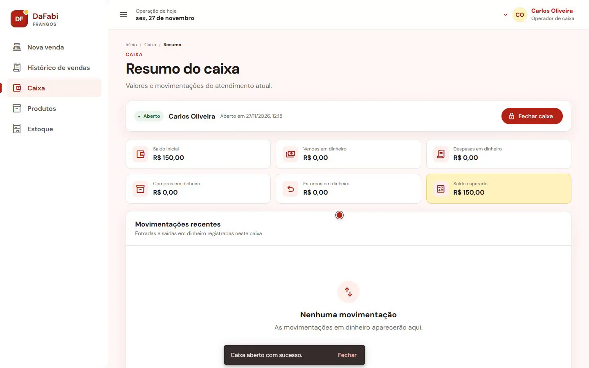
## Vender no balcão

1. Em **Nova venda**, passe o código de barras no leitor (ou digite e tecle Enter). Sem código, toque no produto em **Produtos frequentes** ou use **Pesquisar produtos**.
2. Ajuste a quantidade com o **+** e o **−** no carrinho.
3. Confira o **Total da venda** e clique em **Continuar para pagamento** (ou F2).
4. Escolha **Dinheiro**, **Pix**, **Débito** ou **Crédito**.
5. Em dinheiro, digite o valor recebido ou use **Valor exato**, **R$ 100** ou **R$ 200**. O **Troco** aparece na tela.
6. Clique em **Confirmar pagamento** e devolva o troco indicado.

A venda baixa o estoque na hora. Só o dinheiro entra no caixa físico; Pix e cartão não mudam o saldo da gaveta.

Fontes: Gravação do sistema em funcionamento em 27/11/2026, com dados de exemplo; Regras de caixa, vendas, estorno e compras do sistema (gravacao, regras).

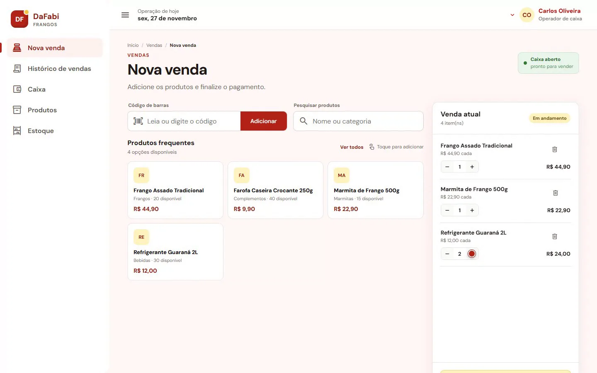
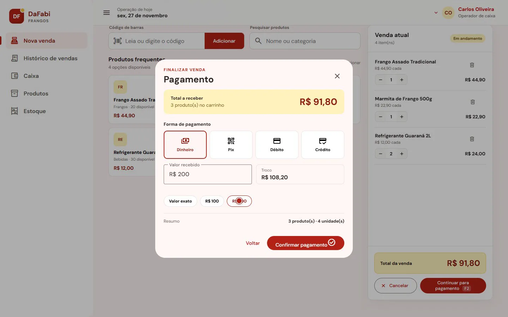
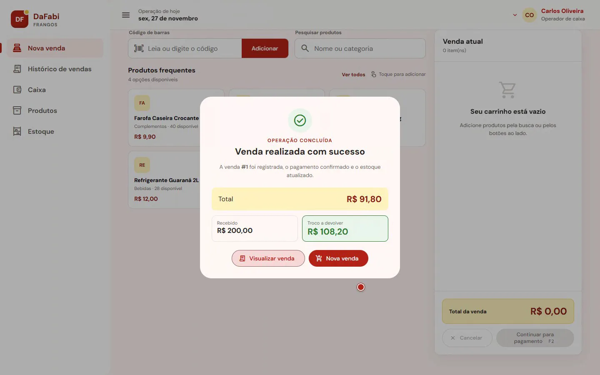
## Receber mercadoria (compra)

Feito pela administradora quando a mercadoria chega.

1. Em **Compras**, clique em **Nova compra**.
2. Escolha o **Fornecedor** e confira a **Data da compra**.
3. Escolha o **Produto**, digite a **Quantidade** e o **Custo unitário**.
4. Para frango e outros perecíveis, digite o **Lote recebido** e a **Validade** da etiqueta.
5. Use **Adicionar item** para outros produtos da mesma nota.
6. Clique em **Registrar compra**.

O estoque já fica disponível. A compra aparece com pagamento **Pendente**: quando pagar, clique em **Pagar** e escolha a forma. Só pagamento em dinheiro sai do caixa.

Fornecedor novo? Cadastre antes em **Fornecedores > Novo fornecedor**.

Fontes: Gravação do sistema em funcionamento em 27/11/2026, com dados de exemplo; Regras de caixa, vendas, estorno e compras do sistema (gravacao, regras).

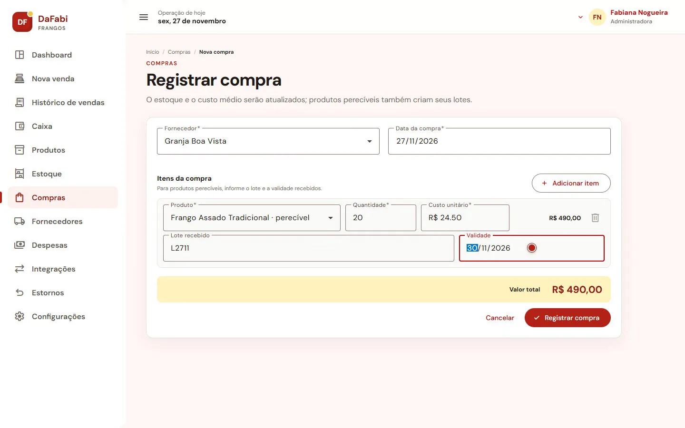
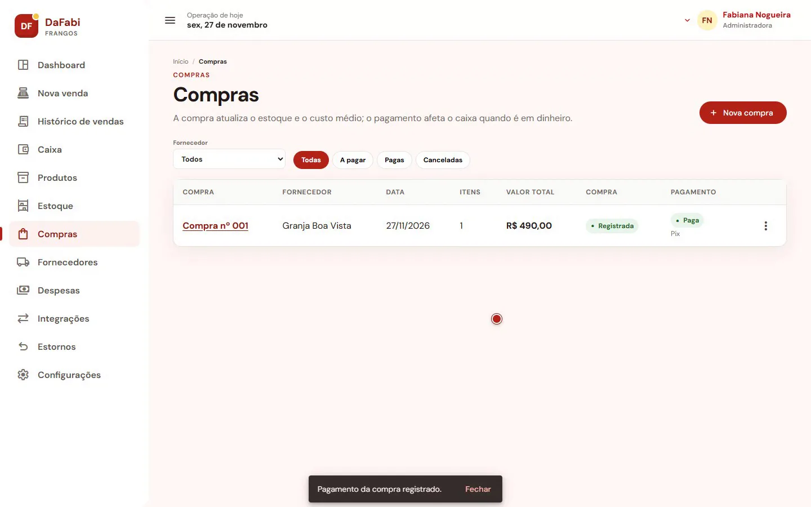
## Conferir lotes e validade

Em **Estoque**, clique em **Perecíveis** para ver cada lote com a validade e a quantidade.

Se aparecer o aviso amarelo "produto perecível tem saldo sem lote", esse saldo **não pode ser vendido**. Conte o produto e use **Vincular saldo** para ligar o saldo a um lote.

Para corrigir uma quantidade que não bate com a prateleira, use **Ajustar** na linha do produto em **Estoque**: digite a quantidade real e o motivo.

Fontes: Gravação do sistema em funcionamento em 27/11/2026, com dados de exemplo; Regras de caixa, vendas, estorno e compras do sistema (gravacao, regras).

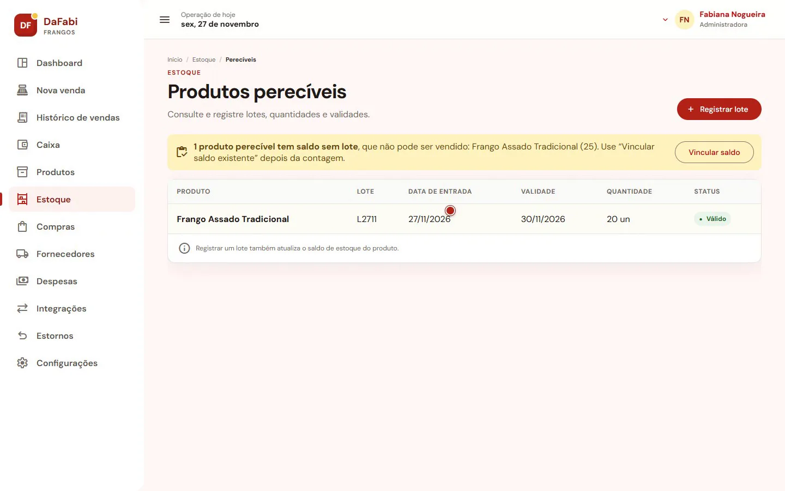
## Lançar uma despesa

1. Em **Despesas**, clique em **Nova despesa**.
2. Preencha **Descrição**, **Categoria**, **Valor**, **Data** e **Forma de pagamento**.
3. Clique em **Registrar despesa**. Ela fica **Pendente**.
4. Quando pagar, clique em **Marcar como paga** e confirme.

Só a despesa paga entra no resultado. Se foi paga em dinheiro, ela também sai do caixa aberto, então marque como paga no mesmo dia em que tirou o dinheiro da gaveta.

Fontes: Gravação do sistema em funcionamento em 27/11/2026, com dados de exemplo (gravacao).

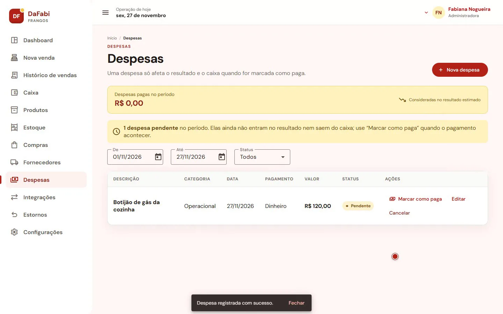
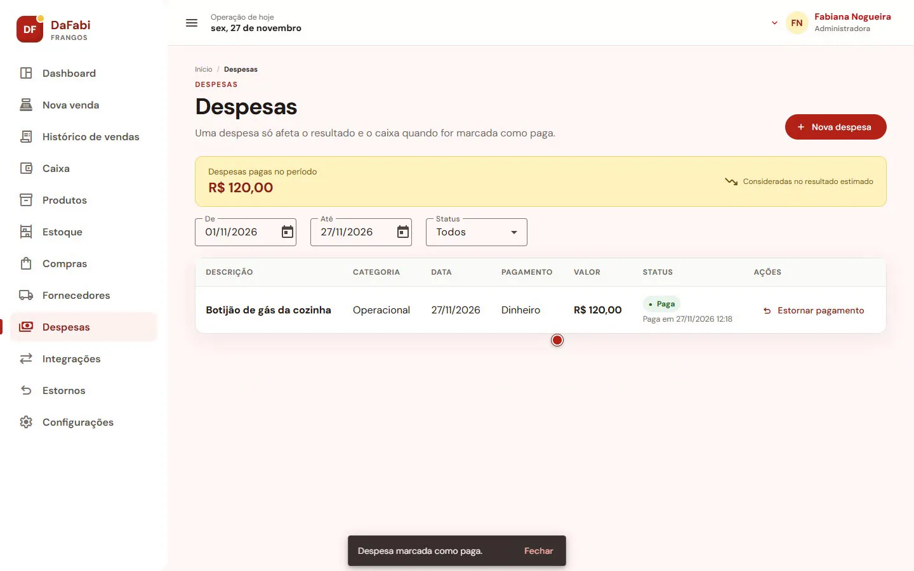
## Desfazer uma venda (estorno)

Só a administradora faz estorno.

1. Em **Estornos**, clique em **Novo estorno**.
2. Digite o **Número da venda** (está no Histórico de vendas) e clique em **Buscar venda**.
3. Confira a data, o pagamento, o valor e os itens.
4. Escreva o **Motivo do estorno**.
5. Clique em **Confirmar estorno** e confirme na janela.

Os produtos voltam ao estoque. Se a venda foi em dinheiro, o mesmo valor sai do caixa: devolva ao cliente pela gaveta. Cada venda só pode ser estornada uma vez.

Fontes: Gravação do sistema em funcionamento em 27/11/2026, com dados de exemplo; Regras de caixa, vendas, estorno e compras do sistema (gravacao, regras).

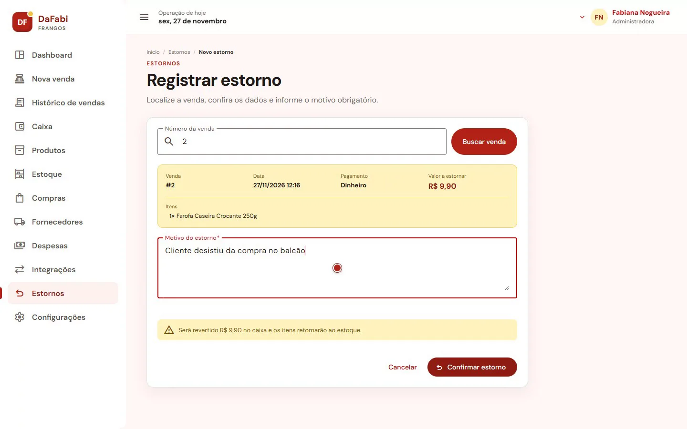
## Fechar o caixa

1. Em **Caixa**, confira o resumo e o **Saldo esperado**.
2. Clique em **Fechar caixa**.
3. Conte o dinheiro e digite o **Valor contado**.
4. Se houver diferença, o sistema mostra o valor e pede a **Justificativa da diferença**. Escreva o motivo.
5. Clique em **Confirmar fechamento** e em **Fechar caixa** na janela.

Depois de fechado, o caixa não aceita vendas até ser aberto de novo.

Fontes: Gravação do sistema em funcionamento em 27/11/2026, com dados de exemplo; Regras de caixa, vendas, estorno e compras do sistema (gravacao, regras).

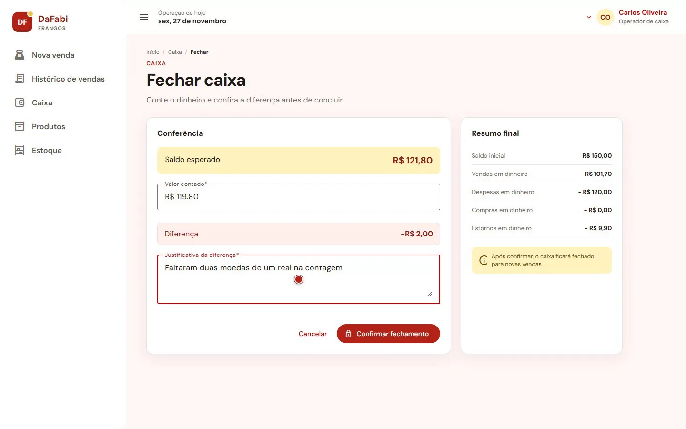
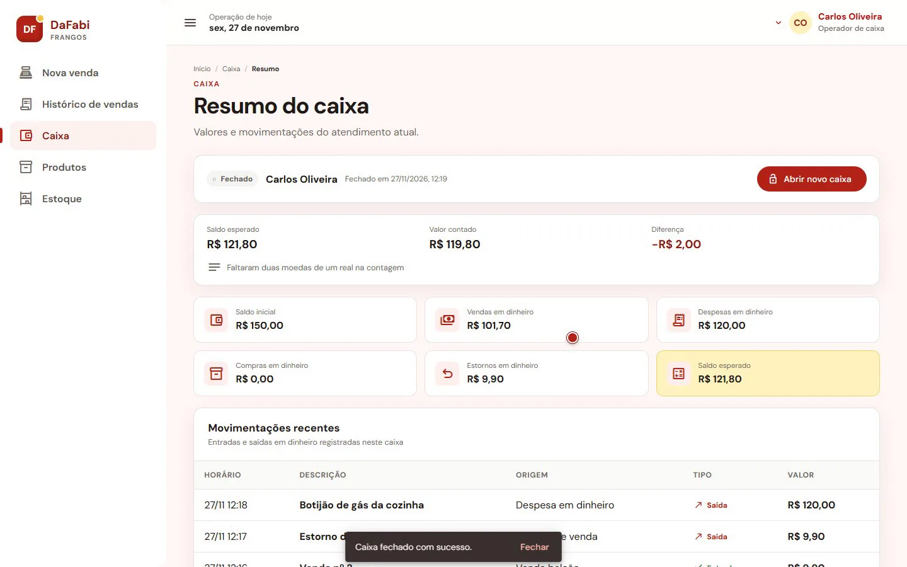
## Importar vendas do iFood e da 99Food

1. Baixe o relatório de pedidos no portal da plataforma.
2. Em **Integrações**, clique em **Abrir integração** na plataforma.
3. Selecione o arquivo e clique em **Analisar relatório**.
4. Confira a prévia: pedidos lidos, cancelados, valores, taxas e linhas inválidas.
5. Clique em **Confirmar este arquivo**.

Importar de novo o mesmo relatório não duplica os pedidos. A importação não mexe no caixa nem no estoque.

Fontes: Gravação do sistema em funcionamento em 27/11/2026, com dados de exemplo; Pendências antes de usar o sistema como controle principal (gravacao, homologacao).

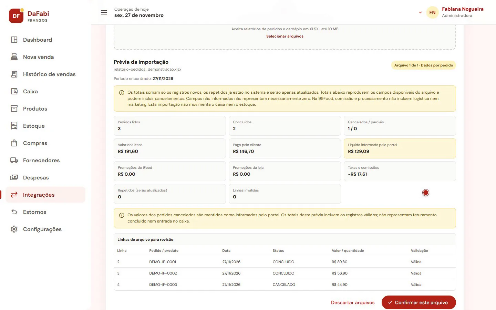
## Ver o resultado do dia

O **Dashboard** mostra faturamento, despesas pagas, taxas do iFood e da 99Food, resultado estimado e quantidade de vendas. Troque o período em **Hoje**, **Últimos 7 dias**, **Este mês** ou **Personalizado**.

O resultado é uma estimativa. Quando há pedidos importados, o painel avisa que o custo das mercadorias desses pedidos ainda não está incluído.

Fontes: Gravação do sistema em funcionamento em 27/11/2026, com dados de exemplo; Regras de caixa, vendas, estorno e compras do sistema (gravacao, regras).

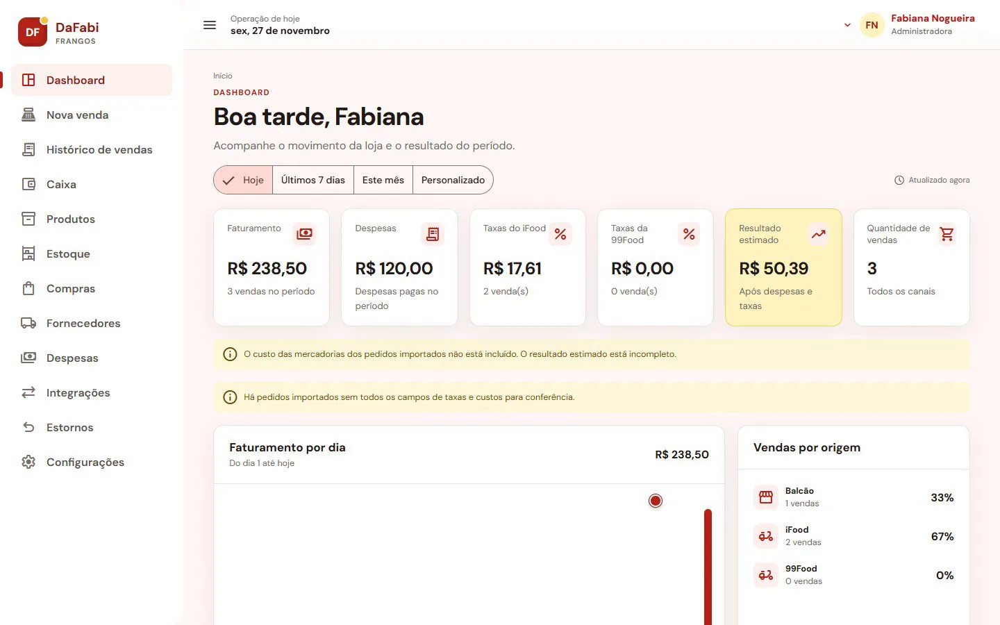
## Problemas comuns

- **"Caixa fechado" no PDV logo depois de entrar, mas o caixa está aberto:** recarregue a página (F5). É um defeito conhecido, já informado à equipe.
- **"Sua sessão expirou" na tela de entrada:** entre normalmente com seu usuário e senha.
- **Produto perecível não aparece para venda:** o saldo está sem lote ou o lote venceu. Veja **Estoque > Perecíveis**.
- **Despesa não aparece no resultado:** ela ainda está **Pendente**. Use **Marcar como paga**.
- **"Acesso não permitido":** essa área é só da administradora.

Fontes: Gravação do sistema em funcionamento em 27/11/2026, com dados de exemplo (gravacao).

## Fontes do pacote

- gravacao: Gravação do sistema em funcionamento em 27/11/2026, com dados de exemplo (comportamento observado).
- regras: Regras de caixa, vendas, estorno e compras do sistema (documentação).
- acessos: Perfis e acessos do sistema (documentação).
- homologacao: Pendências antes de usar o sistema como controle principal (documentação).
