# Demonstração completa do sistema

Produto: DaFabi Frangos | Versão: branch fix/qa-25-11 (b05b67c) | Data: 2026-11-27 | Público: Professores e banca do Trabalho Interdisciplinar

Guia para conhecer e avaliar o Sistema de Gestão da DaFabi Frangos: como rodar localmente, os dois perfis de acesso e cada módulo, do PDV ao painel financeiro. Todas as telas e o vídeo vêm do sistema em execução local com dados sintéticos. Quem responde com este material, pessoa ou IA, responde só com o que está escrito aqui; o que faltar deve ser perguntado à equipe.

## O que o sistema faz

Sistema web de ponto de venda e gestão financeira da DaFabi Frangos. Ele centraliza:

- vendas no balcão por código de barras ou seleção visual, com Dinheiro, Pix, Débito e Crédito;
- abertura, movimentação e fechamento do caixa;
- produtos, estoque, compras, fornecedores e lotes de perecíveis com validade;
- despesas e estornos;
- importação de relatórios do iFood e da 99Food;
- painel com faturamento, despesas, taxas e resultado estimado do período.

**Arquitetura.** Front em Angular 20 com Angular Material, API Spring Boot com PostgreSQL versionado por Flyway e login com tokens JWT. As permissões valem na API: sem token a resposta é 401 e com perfil sem permissão é 403.

Fontes: README do projeto; README da API (regras de estoque, caixa, vendas, estorno e compras); README do front (perfis e acessos de demonstração) (readme, back, front).

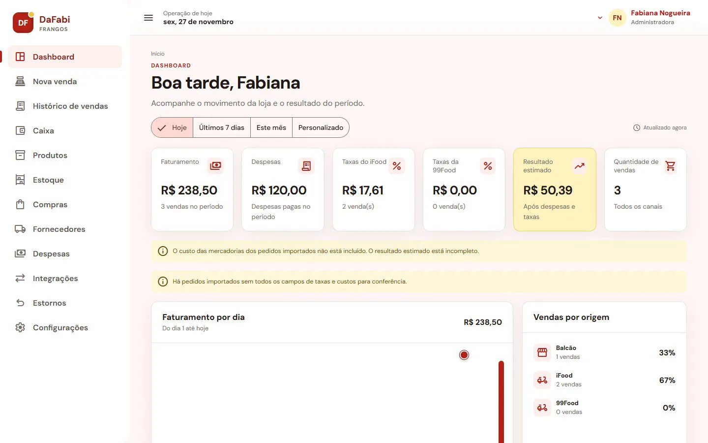
## Como rodar localmente

Pré-requisitos: Java 21 ou superior, PostgreSQL (o projeto traz um docker-compose), Node.js 20.19+ ou 22.12+ e pnpm 10+.

1. Em `Codigo/back`, suba o banco: `docker compose -f src/main/resources/db/docker-compose.yml up -d`.
2. Ainda em `Codigo/back`, rode a API no perfil de desenvolvimento: `./mvnw spring-boot:run -Dspring-boot.run.profiles=dev` (no PowerShell, `.\mvnw.cmd`). A API fica em `http://localhost:8080/api/v1`.
3. Em `Codigo/front`, rode `pnpm install` e `pnpm start`. Abra `http://localhost:4200`.

O perfil `dev` cria os usuários de demonstração e alguns produtos. O perfil padrão é `prod` e exige a variável `JWT_SECRET`.

**Na gravação deste material** não havia Docker na máquina: o banco foi um PostgreSQL 16 descartável iniciado à parte, com o mesmo banco, usuário e senha do docker-compose.

Fontes: README da API (regras de estoque, caixa, vendas, estorno e compras); README do front (perfis e acessos de demonstração); Gravação do sistema em execução local em 27/11/2026, com dados sintéticos (back, front, gravacao).

## Entrada e perfis de acesso

A tela de entrada aceita usuário ou e-mail e senha. Em ambiente de demonstração, os cartões em **Acessos para demonstração** entram com um toque:

- **Administradora** (`admin` / `admin123`): Fabiana Nogueira, vê todos os módulos.
- **Operador de caixa** (`caixa` / `caixa123`): Carlos Oliveira, vê Nova venda, Histórico de vendas, Caixa, Produtos e Estoque.

Se o operador abrir uma área de outro perfil pelo endereço, como o Dashboard, a tela mostra "Acesso não permitido". Os usuários de demonstração devem ser removidos e as senhas trocadas antes do uso real na loja.

Fontes: README do front (perfis e acessos de demonstração); README da API (regras de estoque, caixa, vendas, estorno e compras); Gravação do sistema em execução local em 27/11/2026, com dados sintéticos (front, back, gravacao).

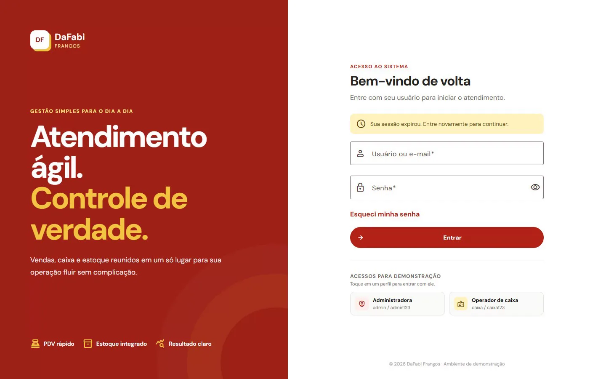
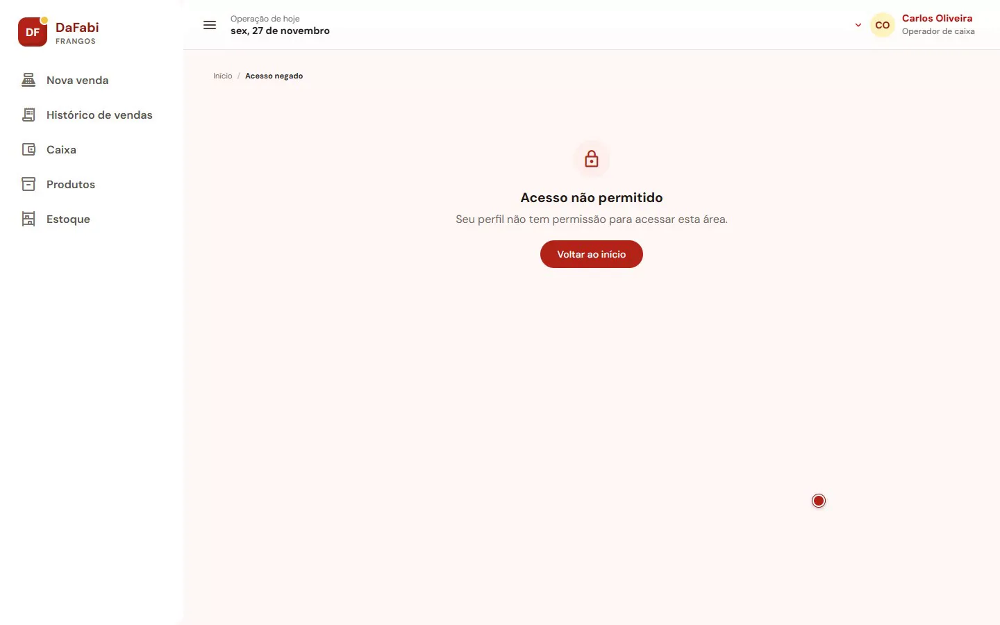
## Produtos

Em **Produtos > Novo produto**, informe nome, categoria, unidade de venda, preço de venda, custo, quantidade inicial em estoque e, se houver, código de barras. Duas opções mudam o comportamento:

- **Produto perecível**: o estoque passa a ser controlado por lote e validade.
- **Exibir nos produtos frequentes do PDV**: o produto vira um botão na tela de venda.

Produtos sem código de barras podem ser vendidos pela pesquisa ou pelos botões visuais. O catálogo filtra por categoria e por status (ativos e inativos).

Fontes: README da API (regras de estoque, caixa, vendas, estorno e compras); Documento de Interface da Sprint 5; Gravação do sistema em execução local em 27/11/2026, com dados sintéticos (back, interface, gravacao).

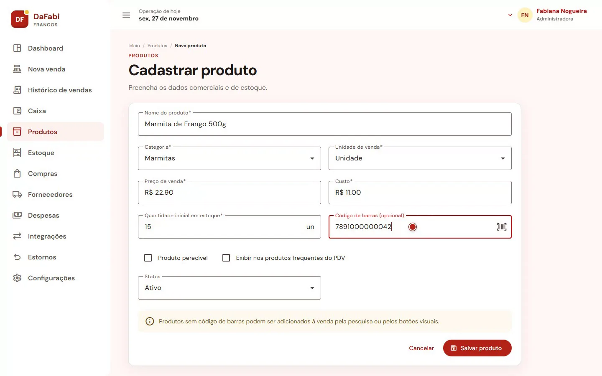
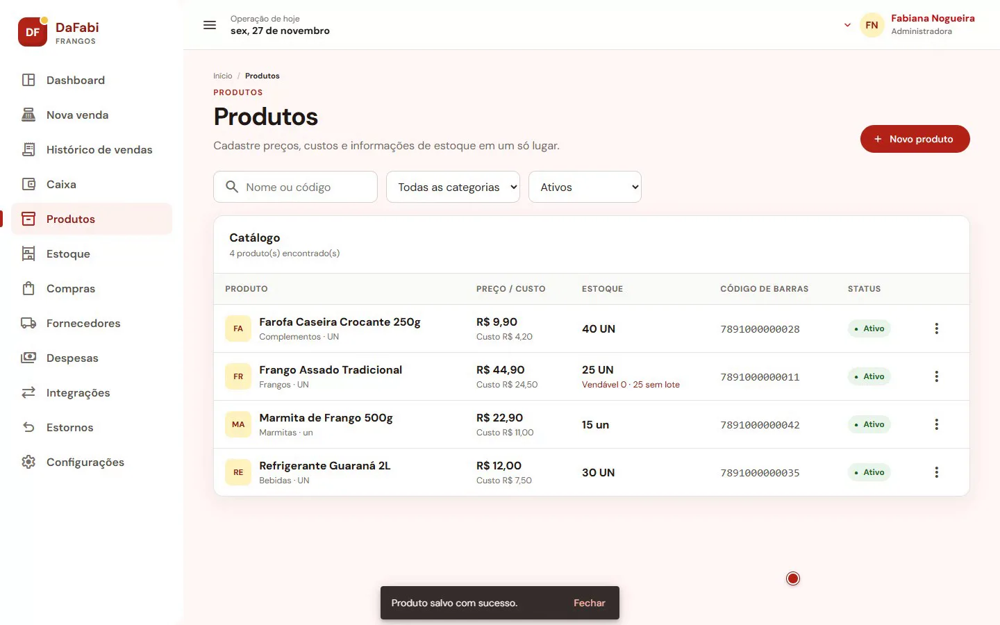
## Fornecedores e compras

**Fornecedores.** Cadastre nome, telefone com DDD, e-mail opcional, observações e status. O e-mail é único por loja e o fornecedor é inativado, nunca excluído. Na lista, telefone e e-mail são links clicáveis.

**Compras.** Em **Compras > Nova compra**, escolha o fornecedor, a data e os itens com quantidade e custo unitário. Para produto perecível, o sistema pede **Lote recebido** e **Validade**. O valor total é calculado. Ao registrar, a quantidade é somada ao estoque, o custo médio é atualizado e o lote é criado, tudo na mesma transação; um item inválido rejeita a compra inteira.

A compra fica com pagamento **Pendente**. Use **Pagar** e escolha a forma (Dinheiro, Pix, Débito, Crédito ou Boleto/transferência). Só o pagamento em dinheiro movimenta o caixa.

Fontes: README da API (regras de estoque, caixa, vendas, estorno e compras); Gravação do sistema em execução local em 27/11/2026, com dados sintéticos (back, gravacao).

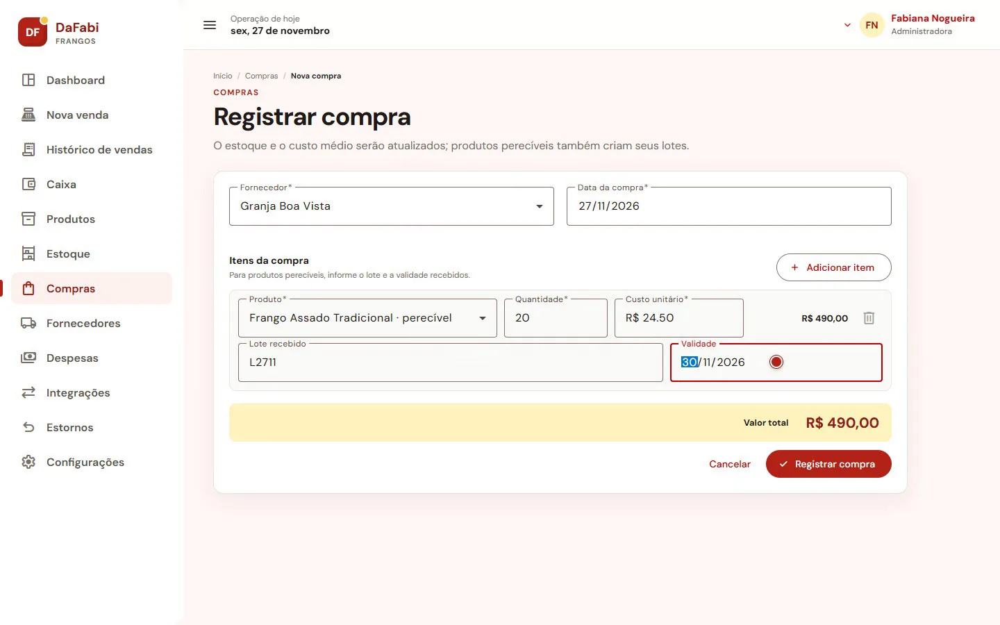
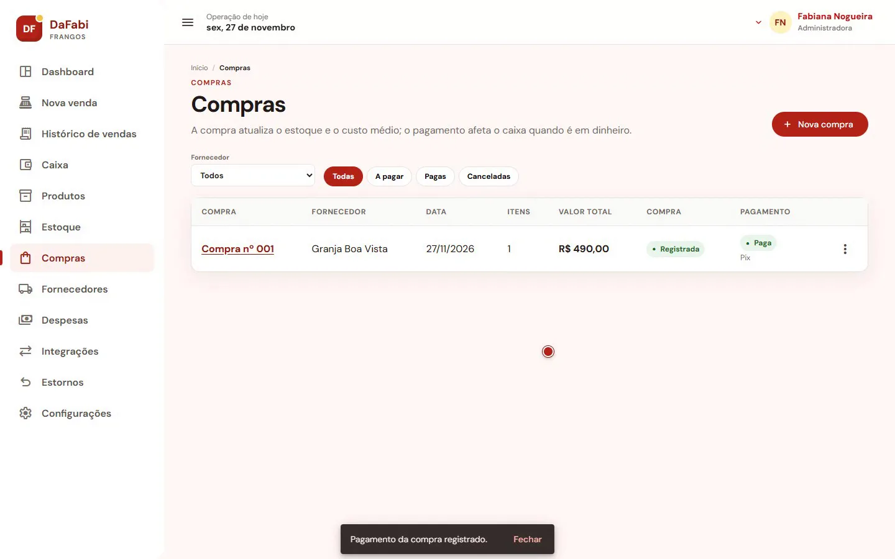
## Estoque e perecíveis

**Posição de estoque** mostra o saldo, o custo e a origem da última movimentação de cada produto. Toda alteração manual é feita em **Novo ajuste** (ou **Ajustar** na linha): informe a nova quantidade e um motivo de pelo menos 5 caracteres; o sistema registra a diferença, o usuário e a data.

**Perecíveis** lista lote, data de entrada, validade, quantidade e status. Registrar um lote também soma ao saldo do produto. Um saldo de perecível **sem lote** não pode ser vendido: o aviso amarelo indica o produto e o botão **Vincular saldo** associa esse saldo a um lote depois da contagem.

Fontes: README da API (regras de estoque, caixa, vendas, estorno e compras); Gravação do sistema em execução local em 27/11/2026, com dados sintéticos; Pendências para homologação na loja (back, gravacao, homologacao).

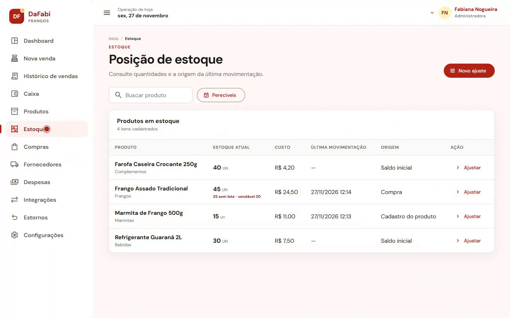
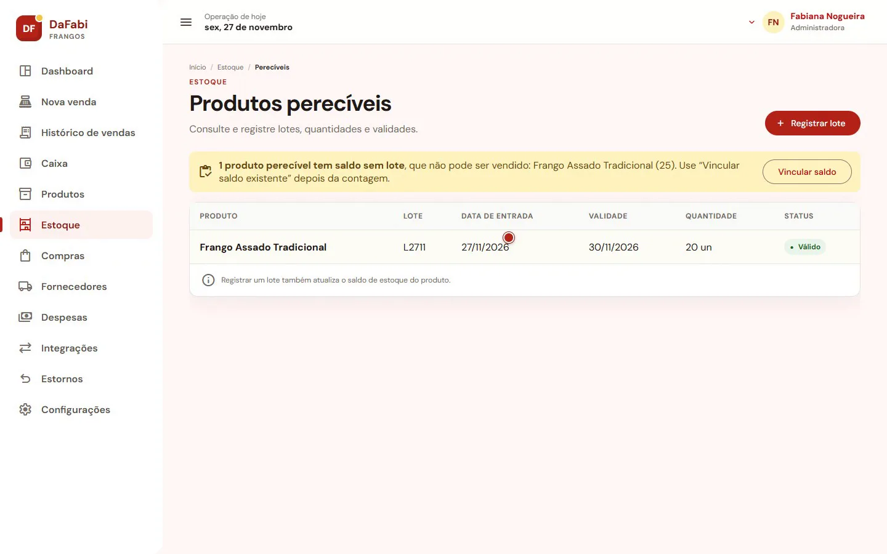
## Caixa: abertura e fechamento

A venda só é concluída com caixa aberto, e há um único caixa aberto por loja.

**Abrir.** Em **Caixa > Abrir caixa** (ou pelo aviso "Caixa fechado" no PDV), conte o dinheiro e informe o **Saldo inicial**. Uma confirmação mostra o valor antes de abrir.

**Resumo.** Mostra saldo inicial, vendas, despesas, compras e estornos em dinheiro, o **Saldo esperado** e as movimentações recentes.

**Fechar.** Em **Fechar caixa**, informe o **Valor contado**. O sistema calcula a diferença para o saldo esperado; se houver diferença, a **Justificativa da diferença** é obrigatória. Depois de confirmar, o caixa fica fechado para novas vendas e o resumo guarda esperado, contado, diferença e justificativa.

Fontes: README da API (regras de estoque, caixa, vendas, estorno e compras); Gravação do sistema em execução local em 27/11/2026, com dados sintéticos (back, gravacao).

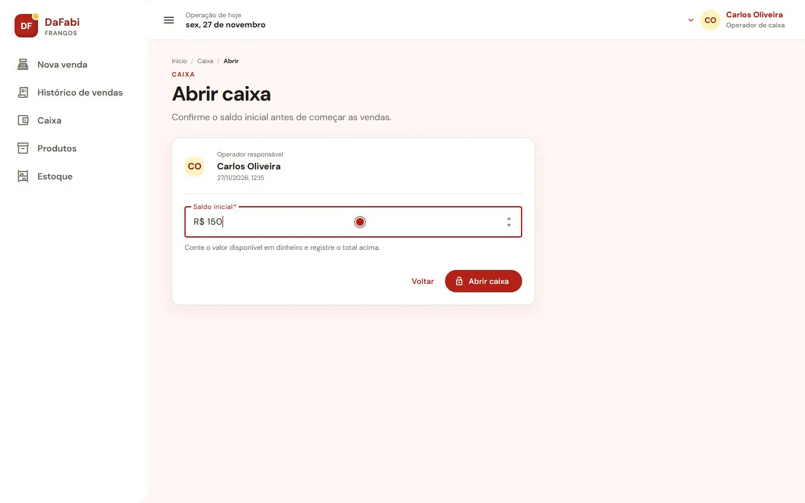
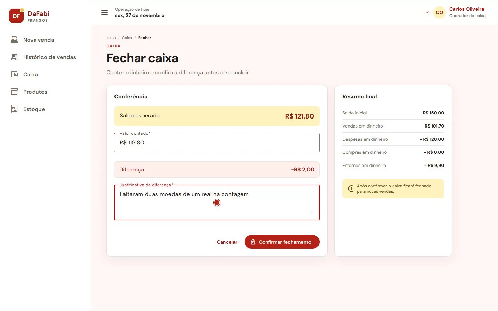
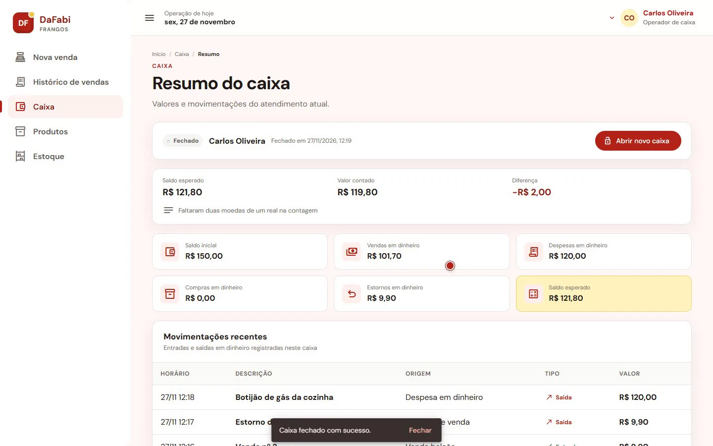
## Venda no PDV

Em **Nova venda**, adicione itens pelo **Código de barras** (leitor ou digitação e Enter), pela **Pesquisa de produtos** ou pelos botões de **Produtos frequentes**. No carrinho, ajuste a quantidade com mais e menos. **Continuar para pagamento** (atalho F2) abre o pagamento: escolha Dinheiro, Pix, Débito ou Crédito. Em dinheiro, digite o valor recebido ou use os atalhos (Valor exato, R$ 100, R$ 200); o troco aparece na hora.

Ao confirmar, o total é recalculado na API pelo preço cadastrado, o estoque de cada item é baixado e, se o pagamento for em dinheiro, a entrada vai para o caixa. A venda usa chave de idempotência para não ser duplicada e bloqueia o estoque para não vender acima do disponível.

Fontes: README da API (regras de estoque, caixa, vendas, estorno e compras); README do front (perfis e acessos de demonstração); Gravação do sistema em execução local em 27/11/2026, com dados sintéticos (back, front, gravacao).

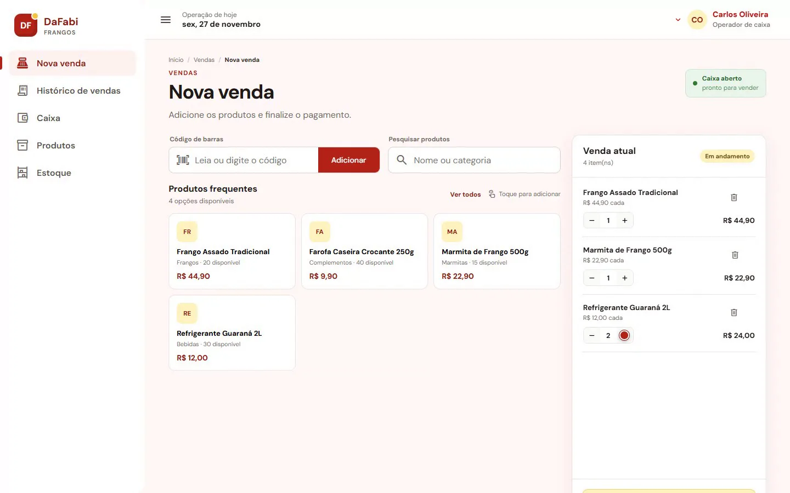
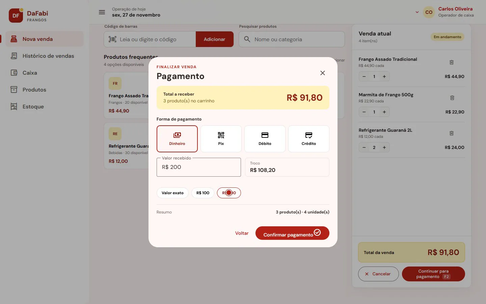
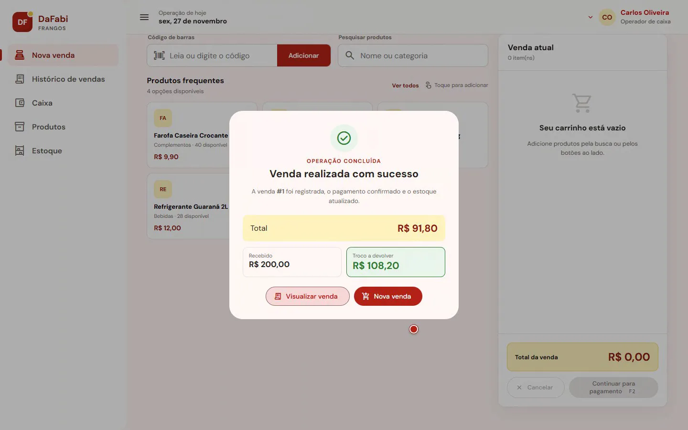
## Histórico de vendas e estorno

**Histórico de vendas** separa vendas de balcão e pedidos de marketplace, com filtros de período, origem, pagamento e status.

**Estorno** é exclusivo da administradora. Em **Estornos > Novo estorno**, busque pelo número da venda, confira os itens e informe o motivo (5 a 500 caracteres). O sistema avisa o valor que será revertido no caixa. Ao confirmar, na mesma transação, os itens voltam ao estoque, sai do caixa exatamente o valor que entrou em dinheiro (Pix e cartão não movimentam o caixa) e a venda fica como estornada. Cada venda aceita um único estorno, e o registro guarda o responsável e o motivo.

Fontes: README da API (regras de estoque, caixa, vendas, estorno e compras); Gravação do sistema em execução local em 27/11/2026, com dados sintéticos (back, gravacao).

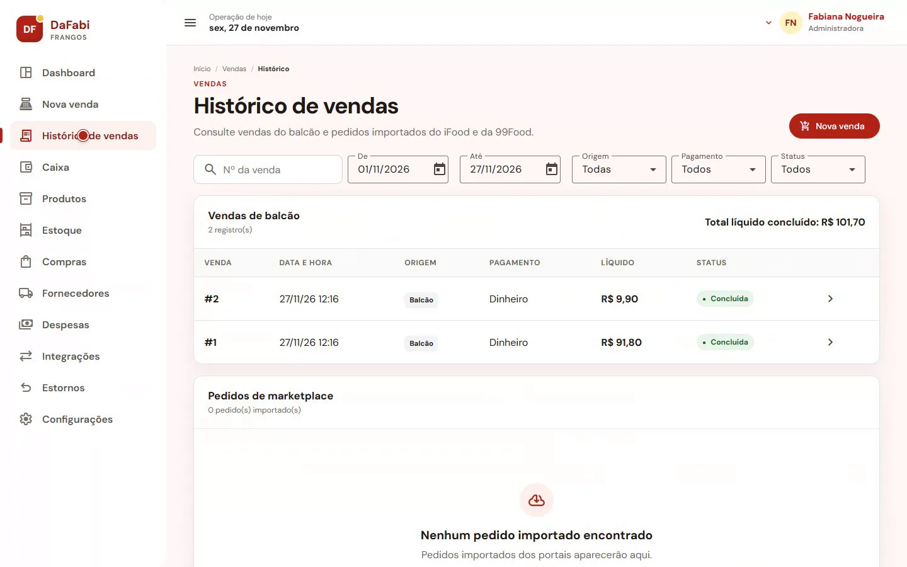
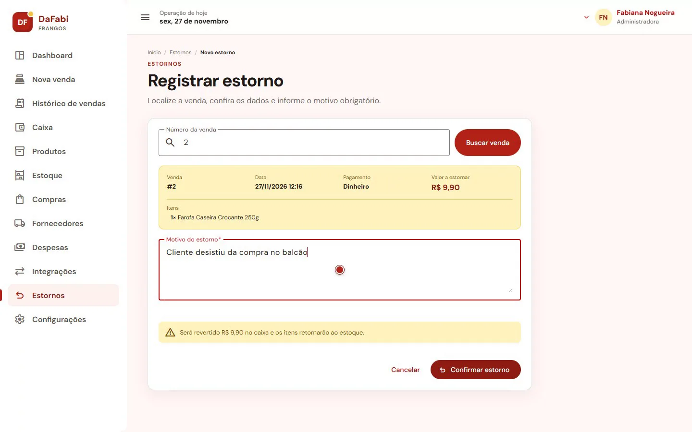
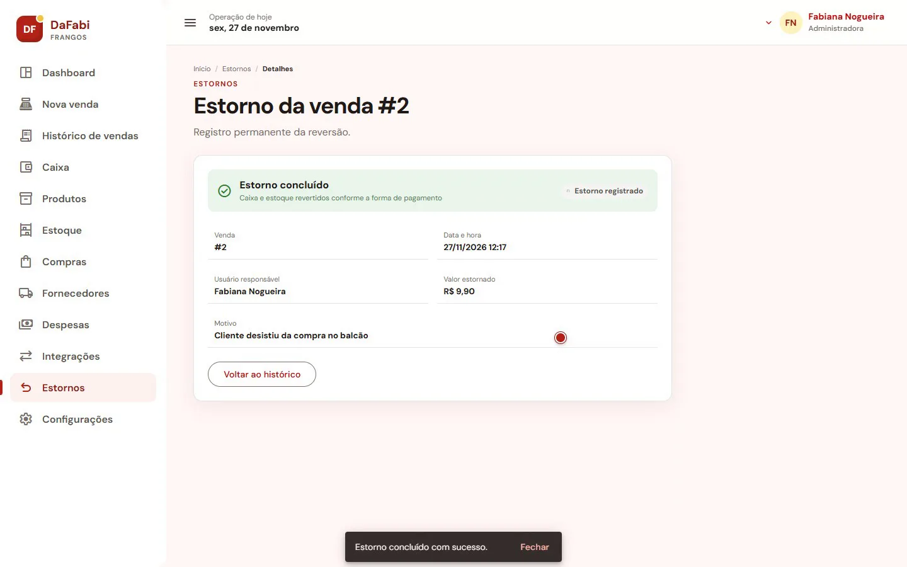
## Despesas

Em **Despesas > Nova despesa**, informe descrição, categoria (Operacional, Materiais, Serviços ou Outros), valor, data, forma de pagamento e observação. A despesa nasce **Pendente** e não entra no resultado nem no caixa. Use **Marcar como paga** quando pagar: ela passa a contar no resultado estimado e, se foi em dinheiro, sai do caixa aberto. O topo da tela soma as despesas pagas no período.

Fontes: Gravação do sistema em execução local em 27/11/2026, com dados sintéticos; README da API (regras de estoque, caixa, vendas, estorno e compras) (gravacao, back).

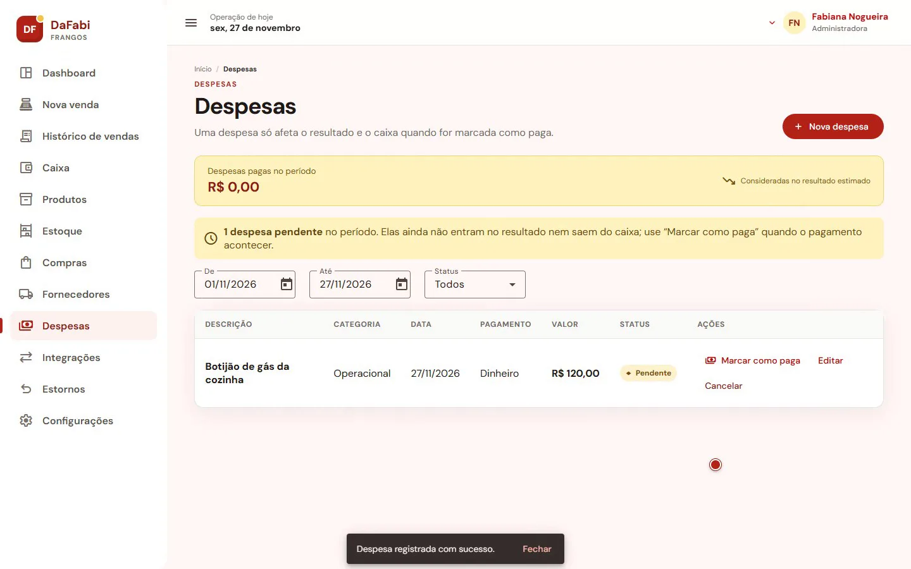
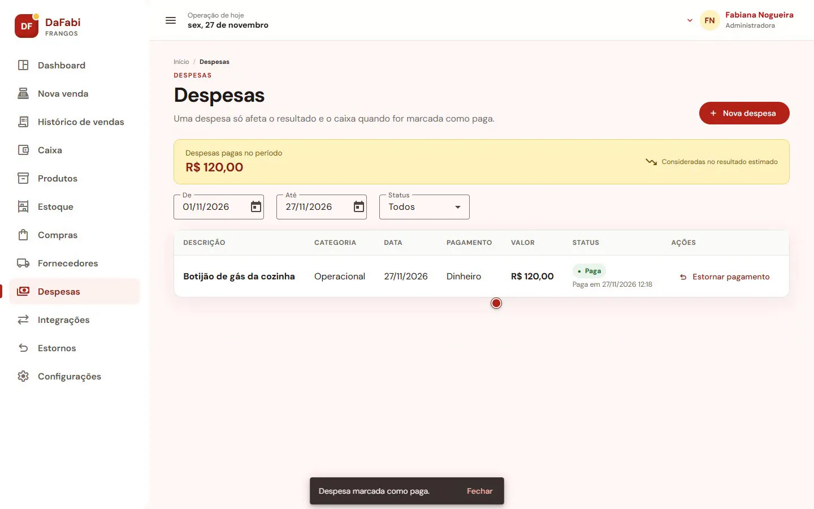
## Integrações iFood e 99Food

Em **Integrações**, cada plataforma tem a importação manual do relatório exportado do portal (XLSX ou ZIP, até 10 MB). Depois de **Analisar relatório**, a **Prévia da importação** mostra pedidos lidos, concluídos, cancelados, valores, taxas, repetidos e linhas inválidas, e a validação de cada linha. Os pedidos só são gravados em **Confirmar este arquivo**. Pedidos repetidos são atualizados, não duplicados.

A importação não movimenta o caixa nem o estoque. O vínculo dos itens exportados com os produtos DaFabi é feito uma vez por loja e item. Na demonstração foi usado um relatório sintético; a conferência com relatórios reais está listada nas pendências de homologação.

Fontes: Gravação do sistema em execução local em 27/11/2026, com dados sintéticos; Pendências para homologação na loja; README do projeto (gravacao, homologacao, readme).

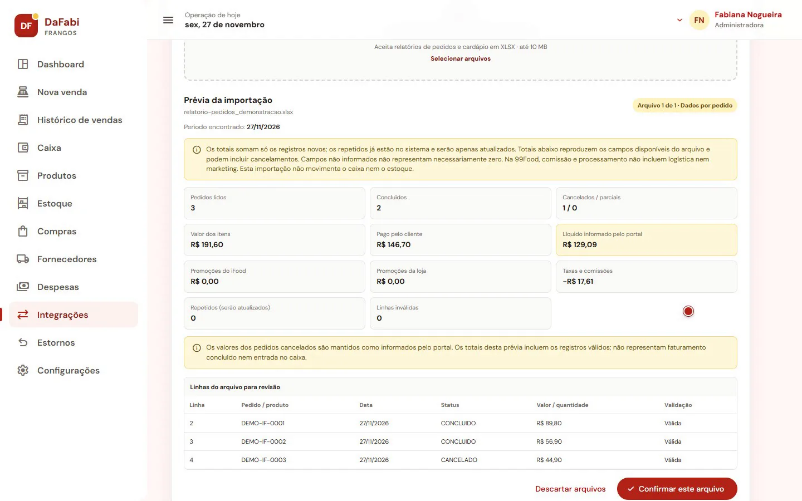
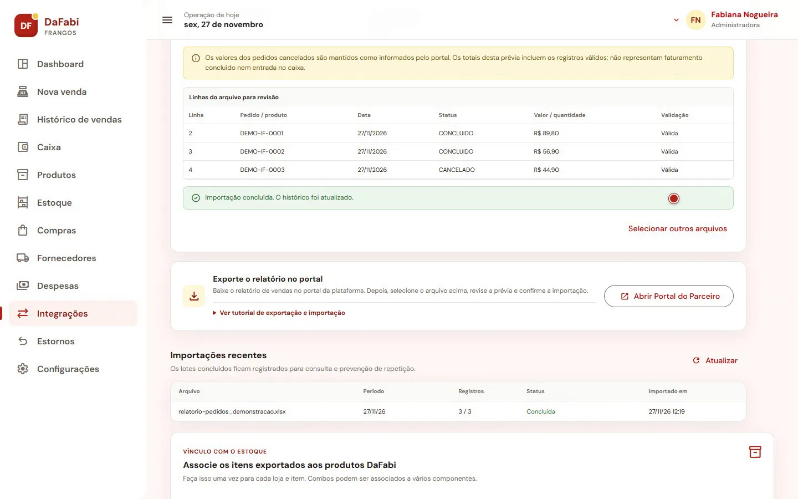
## Dashboard financeiro

O painel da administradora consolida vendas concluídas, despesas pagas e movimentos de caixa no período (Hoje, Últimos 7 dias, Este mês ou Personalizado). Mostra faturamento, despesas, taxas do iFood e da 99Food, resultado estimado, quantidade de vendas, faturamento por dia, vendas por origem, vendas recentes e a composição do resultado.

O painel avisa quando o resultado está incompleto: o custo das mercadorias dos pedidos importados ainda não é reconhecido. Períodos sem dados retornam totais zerados.

Fontes: README da API (regras de estoque, caixa, vendas, estorno e compras); Gravação do sistema em execução local em 27/11/2026, com dados sintéticos; Pendências para homologação na loja (back, gravacao, homologacao).

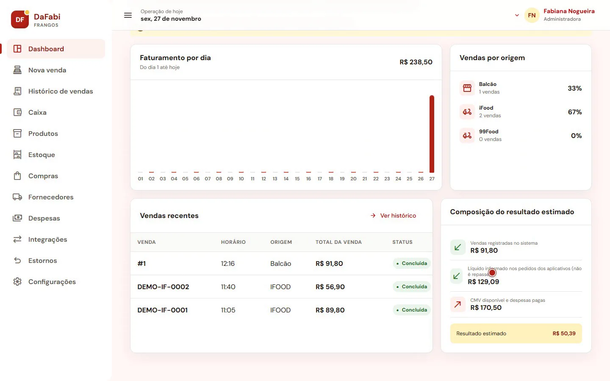
## Configurações

Em **Configurações**, a administradora mantém os dados da loja (nome, telefone, endereço), a forma de pagamento sugerida no PDV e o modo compacto das tabelas. A mesma área tem as seções **Usuários** e **Perfis e permissões**.

Fontes: Gravação do sistema em execução local em 27/11/2026, com dados sintéticos; Documento de Interface da Sprint 5 (gravacao, interface).

## Limites e pendências conhecidas

- O sistema ainda não deve ser o controle principal da loja: as verificações de homologação (contagem inicial, relatórios reais do iFood e 99Food, testes concorrentes, leitor físico e a meta de uma venda de três itens em até 60 segundos) estão pendentes.
- **Defeito observado na gravação:** logo após o login, a consulta do caixa sai antes do token e falha. Até recarregar a página, o PDV pode mostrar "Caixa fechado" com o caixa aberto e a tela de login pode exibir "Sua sessão expirou" no primeiro acesso.
- A interface carrega fontes do Google; sem internet, a aparência muda.

Fontes: Pendências para homologação na loja; Gravação do sistema em execução local em 27/11/2026, com dados sintéticos (homologacao, gravacao).

## Fontes do pacote

- readme: README do projeto (documentação).
- back: README da API (regras de estoque, caixa, vendas, estorno e compras) (documentação).
- front: README do front (perfis e acessos de demonstração) (documentação).
- interface: Documento de Interface da Sprint 5 (documentação).
- homologacao: Pendências para homologação na loja (documentação).
- gravacao: Gravação do sistema em execução local em 27/11/2026, com dados sintéticos (comportamento observado).
